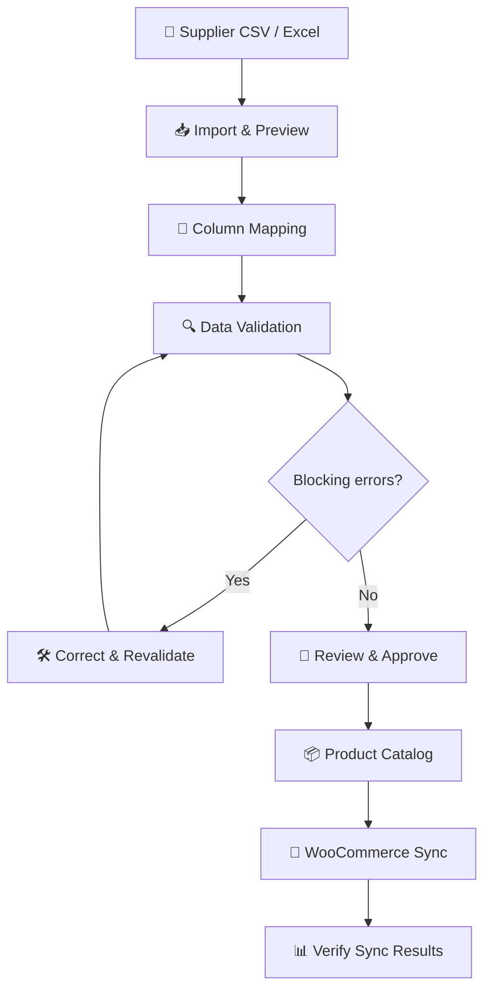

# 🩺 Supplier Data Doctor
### From messy supplier data to store-ready products.

<p align="center">
  <strong>Clean. Validate. Approve. Synchronize.</strong>
</p>

<p align="center">
  A product data management solution that transforms inconsistent supplier spreadsheets into structured, validated product catalogs for e-commerce.
</p>

<p align="center">
  
  
  
</p>

---

## 📌 Overview

Supplier Data Doctor is a **Product Information Management (PIM)** application designed to help businesses clean, standardize, validate, and manage product information received from multiple suppliers.

Supplier spreadsheets often use different column names, formats, units, and product attributes. Before this information can be published online, it needs to be standardized and checked for errors.

Supplier Data Doctor streamlines this process through a unified workflow that takes product data from raw CSV or Excel files to a reviewed and approved catalog, with WooCommerce synchronization available when the store is configured.

## 🌍 The Real-World Problem

**Poor product data is an industry-wide challenge, not just a spreadsheet problem.**

GS1 India has published a report examining the hidden costs of poor product data in Indian e-commerce. It discusses issues such as fragmented product identification, inconsistent attributes, incomplete information, listing problems, and operational inefficiencies.

GS1 also develops global product data standards to help businesses exchange consistent, accurate product information. These industry practices demonstrate why validation and standardization matter in product catalogs.

🔗 **Read the industry reference:** [GS1 India — E-commerce and Product Data Quality Report](https://admin.gs1india.org/uploads/Report_E_Commerce_3_3e63b6caab_df4e2396a3.pdf)

### 🏪 Example: A construction materials retailer

Imagine a retailer receiving tile catalogs from three suppliers:

| Supplier | Incoming data | Problem |
|---|---|---|
| Supplier A | `Item_Name`, `Rate`, `Tile_Size` | Different column names |
| Supplier B | `Product`, `Price`, `Dimensions` | Different field conventions |
| Supplier C | Missing name, `not-a-price`, repeated SKU | Incomplete and invalid data |

Without a standard process, employees must manually compare spreadsheets, correct errors, and prepare product listings.

With Supplier Data Doctor, the retailer can:

- 📥 Import supplier files.
- 🔄 Map different column names to a common schema.
- 🔎 Detect missing names, invalid prices, and duplicate SKUs.
- 🛠️ Correct issues and review records.
- ✅ Approve eligible products.
- 🛒 Publish approved products to WooCommerce when integration is configured.

*This retailer scenario is an illustrative example of how the application can be used; it is not a claim about a particular company's incident.*

---

## ✨ Key Features

### 📥 1. Supplier Data Import
- Import CSV and Excel supplier files.
- Preview source columns and sample rows.
- Reject unsupported file types and handle import errors.
- Download a synthetic sample file for testing.

### 🔄 2. Intelligent Column Mapping
- Map supplier-specific headers to standardized product fields.
- Support fields such as product name, SKU, regular price, dimensions, and surface finish.
- Review mappings before validating the data.

### 🔍 3. Data Quality Validation
- Detect missing required fields.
- Identify invalid or negative prices.
- Detect duplicate SKUs.
- Highlight records that need correction.
- Re-run validation after editing product information.

### 🛠️ 4. Product Review and Approval
- View product-level issues.
- Correct invalid or missing information.
- Approve eligible products.
- Prevent products with blocking validation errors from entering the approved publishing workflow.

### 📦 5. Product Catalog
- Maintain a centralized product catalog.
- Search and filter products.
- View SKU, category, price, completeness, and approval status.
- Track WooCommerce synchronization status where available.

### ⚙️ 6. Attribute Management
- Configure category-specific product attributes.
- Define required and optional fields.
- Manage attribute types and validation rules.
- Support construction tile attributes such as dimensions, color, material, and surface finish.

### 🛒 7. WooCommerce Integration
- Configure WooCommerce REST API credentials on the backend.
- Test store connectivity.
- Publish approved and validated products.
- Track synchronization attempts and outcomes.
- Identify failed records for troubleshooting.

> **Integration status:** Live publishing requires a configured WooCommerce store and valid API credentials. A successful backend health check alone does not prove that WooCommerce is connected. Only report successful synchronization when the store confirms the operation.

---

## 🔁 How It Works



The workflow preserves the distinction between imported data, validated records, approved products, and products confirmed as synchronized.

---

## 🧰 Technology Stack

| Layer | Technologies | Purpose |
|---|---|---|
| Frontend | React, JavaScript | Interactive application and product workflows |
| Build tooling | Vite, npm | Development server and frontend builds |
| UI | CSS, Tailwind CSS where configured, Lucide React | Styling, layout, and icons |
| Backend | Python, FastAPI | API endpoints and application logic |
| Data processing | Pandas, OpenPyXL | CSV and Excel processing |
| Data validation | Pydantic and custom validation rules | Request validation and product quality checks |
| Database | PostgreSQL / Supabase, where configured | Persistent product and workflow data |
| E-commerce | WooCommerce REST API | Store connection and product publishing |
| Testing | Pytest, where configured | Backend workflow tests |
| Version control | Git, GitHub | Source control and collaboration |

---

## 🏗️ System Architecture

```text
┌────────────────────────────────────┐
│           React Frontend           │
│                                    │
│ Dashboard • Import • Review        │
│ Catalog • Attributes • Sync        │
└─────────────────┬──────────────────┘
                  │ HTTP / REST API
                  ▼
┌────────────────────────────────────┐
│           FastAPI Backend          │
│                                    │
│ Import Processing                  │
│ Column Mapping                     │
│ Data Validation                    │
│ Approval Workflow                  │
│ WooCommerce Service                │
└──────────────┬──────────────┬──────┘
               │              │
               ▼              ▼
┌─────────────────────┐  ┌─────────────────────┐
│ Database, if enabled│  │ WooCommerce REST API│
│                     │  │                     │
│ Products & Status   │  │ Store Products      │
│ Workflow Records    │  │ Sync Responses      │
└─────────────────────┘  └─────────────────────┘
```

The frontend communicates with the backend, which handles file processing, validation, persistence, and external store requests. WooCommerce credentials belong on the backend, never in frontend code.

---

## 📂 Project Structure

```text
supplier-data-doctor/
├── backend/
│   ├── app/
│   │   ├── services/
│   │   │   ├── imports.py
│   │   │   ├── validation.py
│   │   │   └── woocommerce.py
│   │   ├── main.py
│   │   ├── routes.py
│   │   ├── schemas.py
│   │   ├── config.py
│   │   └── database.py
│   ├── tests/
│   ├── .env.example
│   └── requirements.txt
├── frontend/
│   ├── public/
│   ├── src/
│   │   ├── components/
│   │   ├── pages/
│   │   ├── services/
│   │   ├── App.jsx
│   │   └── index.css
│   ├── .env.example
│   └── package.json
├── .gitignore
├── README.md
└── package.json
```

---

## 🚀 Getting Started

### Prerequisites

- Python 3.11 or another version supported by the backend dependencies
- Node.js and npm
- Git
- A WooCommerce store with REST API access for live synchronization

### 1. Clone the repository

```bash
git clone https://github.com/Anchal235-creator/supplier-data-doctor.git
cd supplier-data-doctor
```

### 2. Start the backend

From the project root:

```powershell
cd backend
py -3.11 -m venv .venv
.\.venv\Scripts\Activate.ps1
pip install -r requirements.txt
```

Create `backend/.env` using `backend/.env.example` as a reference. Add the environment variables required by the backend configuration.

Start the API:

```powershell
uvicorn app.main:app --reload
```

If the entry-point module differs in your local version, use the module path defined by your application.

If API documentation is enabled, open [http://127.0.0.1:8000/docs](http://127.0.0.1:8000/docs).

### 3. Start the frontend

Open a second terminal from the project root:

```powershell
cd frontend
npm install
npm run dev
```

Open the local address displayed by Vite, usually [http://localhost:5173](http://localhost:5173).

### 4. Configure WooCommerce

1. Set up a WordPress site with WooCommerce installed and activated.
2. Open **WooCommerce → Settings → Advanced → REST API**.
3. Create API credentials with the required product permissions.
4. Configure the store URL, consumer key, and consumer secret in the backend environment file, using the exact variable names expected by your application.
5. Restart FastAPI.
6. Open the **WooCommerce Sync** page and test the connection.
7. Sync an approved product and verify it appears in your store.

🔐 **Security:** Never commit `.env` files, passwords, consumer secrets, or private API keys to GitHub. Use placeholders in `.env.example`, and keep real credentials on the backend.

---

## 🧪 Testing the Application

A practical manual test should cover:

| Test | Expected result |
|---|---|
| Upload a valid supplier CSV | File is parsed and previewed |
| Upload an unsupported `.txt` file | Clear validation error |
| Map unfamiliar source headers | Selected mappings are reflected in the workflow |
| Import a missing product name | Required-field issue is reported |
| Import a negative or non-numeric price | Invalid price is reported |
| Import a duplicate SKU | Duplicate is detected |
| Correct a product and revalidate | The corresponding issue is removed if the value is valid |
| Approve a valid product | Approval status changes |
| Attempt to approve a product with blocking errors | Approval is prevented according to the workflow rules |
| Test WooCommerce with invalid credentials | Connection failure is displayed |
| Sync an approved product with a configured store | The response and final product state are verified |

---

## 🎯 Expected Impact

- ⏱️ Less manual effort spent cleaning supplier spreadsheets.
- 🎯 More consistent product information across suppliers.
- 🔎 Earlier detection of missing and invalid values.
- 🛡️ A review step before product publishing.
- 🔄 A more structured route from supplier data to online catalogs.

These are intended benefits; actual time savings and quality improvements should be measured through testing rather than assumed.

---

## 🛣️ Future Scope

- 🤖 AI-assisted column mapping suggestions.
- 🧩 Reusable templates for different supplier formats.
- 📈 Advanced catalog quality analytics.
- 🔔 Notifications for unresolved data issues.
- 🔁 More robust synchronization retries and recovery.
- 🏬 Multi-supplier and multi-store management.
- 🧾 Audit trails for corrections and approval decisions.

---

## 👩‍💻 Built For

**Kilowott Hackathon — Product Information Management (PIM) Integration**

Supplier Data Doctor explores how supplier onboarding, product data quality, catalog management, and e-commerce integration can work together in a single workflow.

> *“Better product data. Fewer errors. More reliable product listings.”*

---

## 📚 References

- [GS1 India — E-commerce and Product Data Quality Report](https://admin.gs1india.org/uploads/Report_E_Commerce_3_3e63b6caab_df4e2396a3.pdf)
- [GS1 Global Data Model](https://www.gs1.org/services/gdsn/global-data-model)
- [GS1 Global Data Synchronisation Network](https://www.gs1.org/services/gdsn)
- [WooCommerce REST API Documentation](https://developer.woocommerce.com/docs/apis/rest-api/v3/products/)
- [WooCommerce Product CSV Importer/Exporter](https://woocommerce.com/document/product-csv-importer-exporter/)

---

<p align="center">
  <strong>Supplier Data Doctor</strong><br/>
  Transforming supplier data into dependable product information.
</p>
